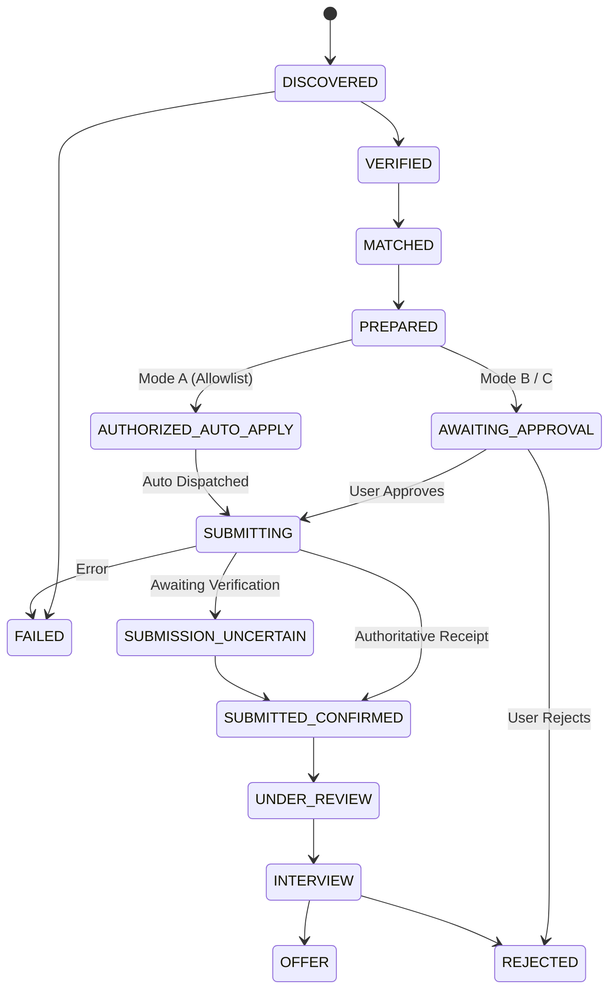

# ARCHITECTURE.md — Global Job Hunter AI Technical Specification

## 1. High-Level System Architecture

```
[Candidate Documents: PDF/DOCX]
              │
              ▼
    [Resume Parser Service]
              │ (Normalized Profile & Evidence)
              ▼
   ┌────────────────────────────────────────────────────────┐
   │                  FastAPI Backend Core                  │
   │                                                        │
   │  [Discovery Engine] ◄──► [Public ATS / APIs / Catalog] │
   │          │                                             │
   │  [Matching Engine]  (0-100 Compatibility Heuristic)    │
   │          │                                             │
   │  [Doc Generator]    (Tailored ATS Summaries & Letters) │
   │          │                                             │
   │  [State Machine]    (Mode A / Mode B / Mode C Engine)  │
   │          │                                             │
   │  [Telegram Agent]   (Real-time Webhook Alerts)         │
   └────────────────────────────────────────────────────────┘
              │                              │
              ▼                              ▼
    [SQLite / PostgreSQL]          [Next.js 14 Dashboard]
```

---

## 2. Application State Machine



---

## 3. Database Schema Overview

* **`users`:** Candidate account record.
* **`candidate_profiles`:** Normalized profile (skills, education, contact, portfolio).
* **`resumes` / `resume_versions`:** Ingested documents and versioned tailored ATS variations.
* **`skills` & `professional_experiences`:** Extracted credentials with evidence context.
* **`job_sources` & `job_postings`:** Canonical job records with eligibility and compensation metadata.
* **`job_matches`:** Compatibility scores with 6-factor weight breakdown.
* **`applications`:** State machine lifecycle records with idempotency keys.
* **`submission_evidence`:** Authoritative confirmation IDs and raw verification receipts.
* **`application_events`:** Immutable audit log tracking status transitions.
* **`automation_policies`:** User-defined safety limits and source allowlists.
