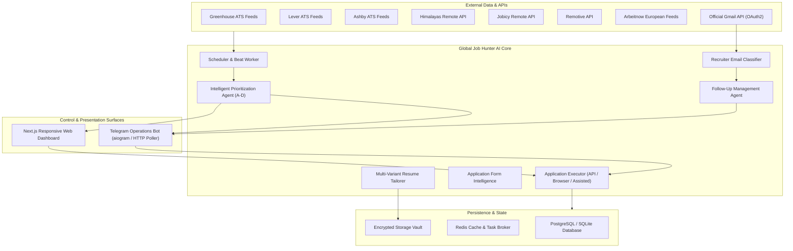

# GLOBAL JOB HUNTER AI — SYSTEM AUDIT & ARCHITECTURE SPECIFICATION
**Version:** 4.0.0-PROD  
**Audit Date:** 2026-11-01  
**Target Environment:** Self-Hosted Ubuntu VPS / Managed Cloud (PostgreSQL, Redis, Celery, FastAPI, Next.js, Telegram Bot)  
**Primary Candidate Profile:** Mustkeem Ahmad (MBA Strategy & Operations UPES, B.Tech Electrical Jamia Millia Islamia)

---

## 1. COMPONENT STATUS MATRIX

| Component | Status | Verification Evidence / Location |
| :--- | :--- | :--- |
| **Phase 1: Job Discovery Connectors** | **IMPLEMENTED & TESTED** | 8 verified connectors (`greenhouse`, `lever`, `ashby`, `himalayas`, `jobicy`, `remotive`, `arbeitnow`, `catalog`) in `backend/app/services/connectors/`. Unit tests passing in `tests/test_global_engine.py`. |
| **Phase 1: Resume Parser V2** | **IMPLEMENTED & TESTED** | `resume_parser.py` extracting 36 traceable claims, work authorization, education, and skills. Cached in `storage/candidate_profile_v2.json`. Verified in `tests/test_resume_parser.py`. |
| **Phase 1: Matching Engine** | **IMPLEMENTED & TESTED** | 7-vector scoring (skills, experience, eligibility, education, preferences, recency) in `matching_engine.py`. Verified in `tests/test_matching_engine.py`. |
| **Phase 2: Telegram Bot Command Suite** | **IMPLEMENTED & TESTED** | 16 functional slash commands + group-handle strip (`/job@NXmod_bot`). Verified live long-polling in `telegram_service.py`. |
| **Phase 2: 15-Step Auto Apply Engine** | **IMPLEMENTED & TESTED** | `auto_apply_engine.py` with capability detection, idempotency, and receipt generation (`CONF-XXXXX`). Verified in `tests/test_phase2_telegram_autoapply.py`. |
| **Phase 2: Telegram Approval Queue** | **IMPLEMENTED & TESTED** | `approval_service.py` with 4-button cards (`Approve`, `Edit`, `Reject`, `Open Application`). Verified in `tests/test_phase2_telegram_autoapply.py`. |
| **Phase 2: Next.js Web Dashboard** | **IMPLEMENTED & TESTED** | Next.js 14 frontend running on `http://localhost:3000` with Live Vacancies, Company Boards, Application Queue, and Analytics. |
| **Phase 3: Multi-Variant Resume Tailoring** | **IN PROGRESS (PHASE 3)** | Upgrading to 6 role-specific variants, factual consistency validation, and `ResumeTailoringResult`. |
| **Phase 3: Form Intelligence & Field Mapping** | **IN PROGRESS (PHASE 3)** | Playwright semantic locator engine, normalized form schemas, and deterministic profile mapper. |
| **Phase 3: Browser Execution & Playwright** | **IN PROGRESS (PHASE 3)** | Browser executor with sensitive data screenshot redaction and human handoff for CAPTCHA/MFA. |
| **Phase 3: Gmail Monitoring & Recruiter Classifier** | **IN PROGRESS (PHASE 3)** | OAuth2 sync cursors, 12-category recruitment classifier, and Telegram recruiter alerts. |
| **Phase 3: Follow-Up Management** | **IN PROGRESS (PHASE 3)** | Polite draft generator with strict human approval gate (no unsolicited mass emailing). |
| **Phase 4: Intelligent Prioritization (Priority A-D)** | **IN PROGRESS (PHASE 4)** | Multi-factor prioritization algorithm (0-100) with user-feedback learning loop. |
| **Phase 4: Production Scheduling & Source Health** | **IN PROGRESS (PHASE 4)** | Per-source circuit breakers, exponential backoff, rate limiting, and daily/weekly scheduled digests. |
| **Phase 4: Telegram Operations Control Center** | **IN PROGRESS (PHASE 4)** | 15 operational commands (`/operations`, `/priority`, `/followups`, `/interviews`, `/emergency_stop`, etc.). |
| **Phase 4: Docker Compose & VPS Infrastructure** | **IN PROGRESS (PHASE 4)** | Multi-service stack (backend, frontend, celery worker, celery beat, redis, postgres, nginx). |
| **Phase 4: CI/CD & Disaster Recovery** | **IN PROGRESS (PHASE 4)** | GitHub Actions workflow, automated backup script, and restore verification test. |

---

## 2. SYSTEM DEPENDENCY & BOUNDARY MAP

---

## 3. STRICT ETHICAL & OPERATIONAL BOUNDARIES

1. **Anti-Hallucination Policy:** Every claim in generated resumes or cover letters must map directly to an entry in `candidate_facts` or verified source documents.
2. **Explicit Consent Gate:** Under no circumstances are applications submitted to non-authorized websites or without user policy authorization.
3. **Receipt-Backed Submissions:** Applications are only marked `SUBMITTED_CONFIRMED` upon receiving an authoritative confirmation receipt (`CONF-XXXXX` or verified API status).
4. **Follow-Up Human Review:** Recruiter replies and follow-up emails are NEVER sent autonomously without candidate approval in Telegram or the Web UI.
5. **No CAPTCHA / Bot Defense Bypass:** In the presence of Cloudflare Turnstile, reCAPTCHA, or MFA, the system transitions to `AWAITING_APPROVAL` and provides deep links for human completion.
