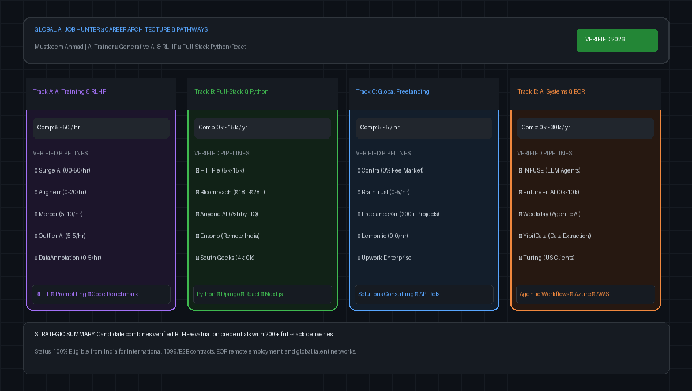

# Global AI Job Hunter & Career Intelligence System


[](https://github.com/Mustkeem324)
[](#)
[](#)
[](#)
[](#)

---

## Visual Career Architecture & Pathways



---

## Table of Contents
1. [SECTION 1 — Resume Intelligence Report](#section-1--resume-intelligence-report)
2. [SECTION 2 — Top 20 Immediate Applications](#section-2--top-20-immediate-applications)
3. [SECTION 3 — AI Training and LLM Evaluation Jobs](#section-3--ai-training-and-llm-evaluation-jobs)
4. [SECTION 4 — Full-Stack and AI Engineering Jobs](#section-4--full-stack-and-ai-engineering-jobs)
5. [SECTION 5 — Freelance and Paid Contract Opportunities](#section-5--freelance-and-paid-contract-opportunities)
6. [SECTION 6 — International Remote Companies (India-Eligible)](#section-6--international-remote-companies-india-eligible)
7. [SECTION 7 — Highest-Paying Suitable Opportunities](#section-7--highest-paying-suitable-opportunities)
8. [SECTION 8 — Quickest Actionable Opportunities](#section-8--quickest-actionable-opportunities)
9. [SECTION 9 — Resume Improvement and Personalized Applications](#section-9--resume-improvement-and-personalized-applications)
10. [SECTION 10 — 7-Day Application Action Plan](#section-10--7-day-application-action-plan)
11. [Repository Database & Usage](#repository-database--usage)

---

## SECTION 1 — Resume Intelligence Report

### Candidate Overview & Academic Credentials
* **Candidate:** Mustkeem Ahmad
* **Location:** Hyderabad / New Delhi, India
* **MBA in Strategy & Operations:** UPES Dehradun (2024–2026) | **CGPA: 8.90 / 10**
* **B.Tech / B.E. in Electrical Engineering:** Jamia Millia Islamia, Delhi (2017–2021) | **83.30% / 8.3 CGPA** (First Class Honours)
* **Certifications:** Full Stack Development (React + Node.js) — Coding Ninjas; Web Scraping with Python & BeautifulSoup — Coursera; Intro to Programming Using Python — Great Learning.

### Technical Skills & Frameworks
* **AI & LLM Training:** Reinforcement Learning from Human Feedback (RLHF), LLM evaluation, prompt engineering, multimodal review, red teaming, model reasoning benchmarking, intent parsing.
* **Backend Engineering:** Python (Django, FastAPI, scikit-learn, Web3.py, BeautifulSoup), Node.js, Express.js, GraphQL, Apollo Client, REST APIs, JWT, Socket.IO.
* **Frontend Engineering:** React.js, Next.js, Redux, TypeScript, JavaScript (ES6+), HTML5, CSS3, Bootstrap, Figma.
* **Databases & Cloud:** PostgreSQL, MongoDB, MySQL, Redis, AWS (S3, EC2, Lambda), Azure, Docker, Git, CI/CD.

### Professional Experience Summary
* **AI Trainer / LLM Evaluation Contributor — Handshake Project Dynamo (Feb 2026 – Present):** Structured review, instruction-following assessment, reasoning quality benchmarking, evidence-based feedback.
* **Generative AI Engineer & Model Evaluation Consultant (Contract) — Outlier AI (Mar 2024 – Present):** LLM quality evaluation, accuracy/safety scoring, RLHF-style criteria assessment, multimodal review.
* **Lead - Full Stack & AI Innovation — Unitechie Solutions Pvt. Ltd. (Oct 2025 – Feb 2026):** Architecture and delivery of AI platforms combining LLMs, automation pipelines, APIs, and cloud services (AWS/Azure).
* **Founder & Managing Consultant — FreelanceKar.com (Mar 2021 – Present):** Delivered **200+ client projects** across AI agents, API engineering, full-stack products, and cloud infrastructure.

---

## SECTION 2 — Top 20 Immediate Applications

| # | Company / Platform | Job Title | Work Arrangement | Disclosed Pay | Match Score | Direct Application URL |
|---|--------------------|-----------|------------------|---------------|-------------|------------------------|
| 1 | **Surge AI** | Senior Software Engineer: Agentic Coding RL Environments | Remote Worldwide | **$100 – $150 / hr** | **95/100** | [Apply on Surge AI](https://www.surgehq.ai/careers) |
| 2 | **Alignerr (Labelbox)** | Software Engineer - AI Training / Python Task Author | Remote Worldwide | **$60 – $120 / hr** | **94/100** | [Apply on Alignerr](https://www.alignerr.com/) |
| 3 | **Mercor** | Software Engineer & AI Evaluation Expert | Remote Worldwide | **$45 – $110 / hr** | **93/100** | [Apply on Mercor](https://app.ashbyhq.com/mercor) |
| 4 | **HTTPie** | Senior Fullstack Engineer (Python + React/Next.js) | Remote Worldwide | **$75,000 – $115,000 / yr** | **92/100** | [Apply on HTTPie](https://app.ashbyhq.com/httpie) |
| 5 | **Outlier AI** | Remote Coding Specialist for AI Training (Python/JS) | Remote Worldwide | **$35 – $55 / hr** | **96/100** | [Apply on Outlier AI](https://outlier.ai) |
| 6 | **Anyone AI** | Full-Stack Developer - AI Trainer | Remote India | **Competitive Retainer** | **93/100** | [Apply on Anyone AI](https://app.ashbyhq.com/anyoneai) |
| 7 | **Bloomreach** | Software Engineer II (Fullstack - AI Agents Platform) | Remote India | **₹18,00,000 – ₹28,00,000 / yr** | **90/100** | [Apply on Bloomreach](https://boards.greenhouse.io/bloomreach) |
| 8 | **INFUSE** | Senior AI Engineer (LLM Agents & Workflows) | Remote Worldwide | **$50 – $80 / hr** | **89/100** | [Apply on Greenhouse](https://boards.greenhouse.io/) |
| 9 | **DataAnnotation.tech** | Software Developer – Coding AI Trainer | Remote Worldwide | **$40 – $45 / hr** | **91/100** | [Apply on DataAnnotation](https://dataannotation.tech) |
| 10 | **Mindrift** | Python Domain Expert / AI Tutor | Remote Worldwide | **Up to $90 / hr** | **92/100** | [Apply on Mindrift](https://mindrift.ai) |
| 11 | **Invisible Technologies** | Advanced AI Data Trainer (Python / Code Review) | Remote Worldwide | **$20 – $40 / hr** | **88/100** | [Apply on Greenhouse](https://boards.greenhouse.io/invisibletechnologies) |
| 12 | **Turing** | Python + Full-Stack Developer (AI & Web) | Remote Worldwide | **$30 – $65 / hr** | **90/100** | [Apply on Turing](https://turing.com/jobs) |
| 13 | **Ensono** | Senior Full Stack Developer (Python/FastAPI + React) | Remote India | **Market Standard (INR)** | **87/100** | [Apply on Greenhouse](https://boards.greenhouse.io/ensono) |
| 14 | **South Geeks** | Senior Fullstack Engineer (Python/Django + React) | Remote Worldwide | **$4,500 – $7,500 / mo** | **89/100** | [Apply on South Geeks](https://app.ashbyhq.com/southgeeks) |
| 15 | **Braintrust** | Full-Stack & AI Solutions Engineer | Remote Worldwide | **$50 – $95 / hr** | **88/100** | [Apply on Braintrust](https://www.usebraintrust.com/jobs) |
| 16 | **Handshake AI** | AI Evaluation Contributor (Dynamo Scale Track) | Remote Active | **$20 – $35 / hr** | **97/100** | [Apply on Handshake](https://joinhandshake.com/ai) |
| 17 | **Evolver** | Senior GenAI Engineer (Python + Azure) | Remote India | **Market Standard (INR)** | **86/100** | [Apply on Evolver](https://boards.greenhouse.io/evolver) |
| 18 | **SlideSpeak AI** | Full Stack Software Engineer (Python/FastAPI + React) | Remote Worldwide | **~$60,000 / yr** | **88/100** | [Apply on RemoteOK](https://remoteok.com/) |
| 19 | **Remotebase** | Full-Stack Developer (Python + React + PostgreSQL) | Remote Worldwide | **$25 – $50 / hr** | **87/100** | [Apply on Remotebase](https://remotebase.com/jobs) |
| 20 | **TELUS Digital AI** | AI Data Evaluator & Quality Assurance Rater | Remote India | **$10 – $18 / hr** | **85/100** | [Apply on TELUS Portal](https://jobs.telusdigital.com/) |

---

## SECTION 3 — AI Training and LLM Evaluation Jobs

1. **Scale AI (Human Frontier Collective):** Focuses on frontier coding benchmarks and math evaluations ($30–$60/hr). [scale.com/careers](https://scale.com/careers)
2. **OneForma (Centific):** Regular openings for code evaluation and multilingual LLM judging ($15–$30/hr). [oneforma.com](https://www.oneforma.com)
3. **CrowdGen (Appen):** Microtask and long-term prompt evaluation projects. [crowdgen.com](https://crowdgen.com)
4. **RWS Group (TrainAI Community):** Annotation, NLP quality control, and model calibration. [RWS Workzone Portal](https://workzoneapplication.rws.com/WorkzoneApplicationPortal/)
5. **Toloka AI:** Algorithmic and STEM problem-solving tasks ($15–$35/hr). [toloka.ai](https://toloka.ai)
6. **Welocalize (Welo Data):** AI language trainer and search quality rating in India. [app.welodata.ai](https://app.welodata.ai)
7. **Neevo (Defined.ai):** Periodic technical data evaluation tasks. [neevo.defined.ai](https://neevo.defined.ai)

---

## SECTION 4 — Full-Stack and AI Engineering Jobs

1. **Weekday:** Agentic AI Engineer (Remote India) — ₹15L–₹25L/yr. [jobs.lever.co/weekday](https://jobs.lever.co/weekday)
2. **Drivetrain:** Backend / Full Stack Engineer (Remote India) — ₹18L–₹30L/yr. [jobs.lever.co/drivetrain](https://jobs.lever.co/drivetrain)
3. **RevenueBase:** Full Stack Developer (Python/Cloud) (Remote Worldwide) — $50k–$75k/yr. [app.ashbyhq.com/revenuebase](https://app.ashbyhq.com/revenuebase)
4. **CSC Generation:** Senior Full Stack Engineer (Remote India). [jobs.lever.co/cscgeneration](https://jobs.lever.co/cscgeneration)
5. **FutureFit AI:** Senior AI Engineer (Remote Worldwide) — $80k–$110k/yr. [app.ashbyhq.com](https://app.ashbyhq.com/)
6. **YipitData:** AI Engineer (Data Extraction & Automation) (Remote India). [boards.greenhouse.io](https://boards.greenhouse.io/)
7. **Fluence International:** Full-Stack Developer (Remote Worldwide) — $3,500–$5,000/mo. [remotive.com](https://remotive.com)

---

## SECTION 5 — Freelance and Paid Contract Opportunities

1. **Contra:** 0% commission marketplace for independent developers. Rates: $35–$90/hr. [contra.com/hire/fullstack-engineers](https://contra.com/hire/fullstack-engineers)
2. **Upwork Enterprise:** Tailored profiles for LLM evaluation and Python automation. Rates: $35–$75/hr. [upwork.com](https://www.upwork.com)
3. **Lemon.io:** Direct startup client matching for senior Python/Django/React engineers ($40–$70/hr). [lemon.io](https://lemon.io)
4. **Toptal:** Exclusive freelance network ($50–$100/hr). [toptal.com/developers](https://toptal.com/developers)
5. **CodeMentorX:** Hourly code consulting and debugging ($30–$80/hr). [codementor.io](https://www.codementor.io)

---

## SECTION 6 — International Remote Companies (India-Eligible)

* **HTTPie** (Developer Tools / APIs) — Worldwide contractor / EOR
* **Bloomreach** (AI Commerce) — Direct India entity hiring
* **Ensono** (Cloud Solutions) — India remote engineering hubs
* **Drivetrain** (FP&A Automation) — Remote India
* **Weekday** (Agentic AI) — Remote India
* **EPAM Anywhere** (Global Consulting) — India contractor / FTE
* **BairesDev** (Staff Augmentation) — International B2B contractor

---

## SECTION 7 — Highest-Paying Suitable Opportunities

1. **Surge AI:** $100 – $150 / hr (Agentic Coding RL)
2. **Alignerr:** $60 – $120 / hr (Python Task Author)
3. **Ginas Tech AI:** $140,000 – $190,000 / yr (Full Stack AI Systems)
4. **FutureFit AI:** $80,000 – $110,000 / yr (Senior AI Engineer)
5. **HTTPie:** $75,000 – $115,000 / yr (Senior Fullstack Engineer)
6. **Mindrift:** Up to $90 / hr (Python Domain Expert)
7. **Mercor:** $45 – $110 / hr (AI Evaluation & Eng)
8. **Toptal / Braintrust:** $50 – $100 / hr (Contractor engagements)

---

## SECTION 8 — Quickest Actionable Opportunities

1. **Outlier AI (Internal Upgrade):** Complete the Python/Coding qualification assessment to immediately access higher-tier queues ($35–$55/hr).
2. **Mercor:** Complete the 20-minute AI screening on [Mercor](https://app.ashbyhq.com/mercor) for immediate indexing.
3. **DataAnnotation.tech:** Complete the open coding assessment at [dataannotation.tech](https://dataannotation.tech).
4. **Handshake Project Dynamo:** Increase active weekly task allocation.
5. **Alignerr:** Submit CV and take the automated Python assessment test on [Alignerr](https://www.alignerr.com/).

---

## SECTION 9 — Resume Improvement and Personalized Applications

### Recommended ATS Professional Summary
> *"AI Engineer and Full-Stack Developer with 2+ years of specialized experience in LLM evaluation, prompt engineering, and RLHF workflows alongside commercial web and backend API delivery. Founder of FreelanceKar with 200+ shipped client projects spanning AI agents, Python automation pipelines, Next.js applications, and cloud systems on AWS and Azure. MBA in Strategy & Operations (UPES, 8.90 CGPA) and B.Tech in Electrical Engineering (Jamia Millia Islamia, 83.3%). Active contributor to frontier AI model evaluation programs (Project Dynamo, Outlier AI)."*

### Reusable Master Application Pitch
```text
Subject: Application: [Job Title] — Mustkeem Ahmad (AI Engineer & Full-Stack Developer)

Dear Hiring Team,

I am writing to express my strong interest in the [Job Title] role at [Company Name]. 

As an AI engineer and full-stack developer who is actively contributing to frontier LLM evaluation at Handshake Project Dynamo and Outlier AI—while also having delivered over 200 independent full-stack and automation projects through FreelanceKar—I bring a dual perspective that bridges model quality assessment with robust software engineering.

Key highlights of my background include:
• AI Model Quality & Evaluation: Hands-on experience with RLHF rubrics, model reasoning benchmarks, instruction-following validation, and prompt engineering.
• Full-Stack & Systems Architecture: Proficient in Python (Django, FastAPI), TypeScript/JavaScript (React, Next.js, Node.js), GraphQL, and relational/NoSQL databases (PostgreSQL, MongoDB).
• End-to-End Execution: Shipped autonomous AI agents (LLM-driven smart scheduling), on-chain Web3 trading bots, real-time Socket.IO systems, and cloud deployments on AWS and Azure.
• Academic Rigor: MBA in Strategy & Operations (UPES, 8.90 CGPA) and B.Tech in Electrical Engineering (Jamia Millia Islamia, First Class 83.3%).

My portfolio and verifiable code repositories are available at:
• GitHub: https://github.com/Mustkeem324
• Portfolio & Practice: https://freelancekar.com

I am based in India and available for remote full-time employment or independent contractor engagements across global time zones.

Sincerely,  
Mustkeem Ahmad  
+91-7905800532 | mustkeem324@gmail.com | Hyderabad / New Delhi, India
```

---

## SECTION 10 — 7-Day Application Action Plan

* **Day 1:** Apply to Surge AI, Alignerr, Mercor, and request Outlier coding queue upgrade.
* **Day 2:** Apply to HTTPie, Anyone AI, DataAnnotation.tech, and Mindrift.
* **Day 3:** Apply to Bloomreach, INFUSE, Invisible Technologies, and Turing.
* **Day 4:** Apply to Ensono, South Geeks, Weekday, and activate Braintrust.
* **Day 5:** Launch specialized service profiles on Contra and Upwork; apply to SlideSpeak and Remotebase.
* **Day 6:** Establish fallback hourly pipelines on OneForma, CrowdGen, TELUS, and RWS.
* **Day 7:** Complete pending coding assessments, follow up with technical recruiters on LinkedIn, and review pipeline metrics.

---

## Repository Database & Usage

### Inspecting Database via CLI
```bash
python3 scripts/verify_openings.py
```

### Raw Datasets
* Structured JSON: [`database/opportunities.json`](database/opportunities.json)
* Structured CSV: [`database/opportunities.csv`](database/opportunities.csv)
* Candidate Dossier: [`docs/CANDIDATE_PROFILE.md`](docs/CANDIDATE_PROFILE.md)
* ATS Guide: [`docs/ATS_RESUME_GUIDE.md`](docs/ATS_RESUME_GUIDE.md)

---
*Created by [Mustkeem Ahmad](https://github.com/Mustkeem324) • Verified November 2026*
