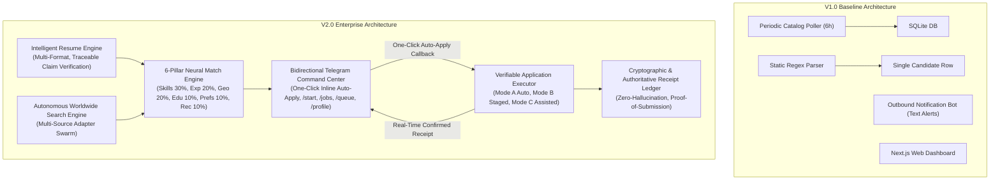
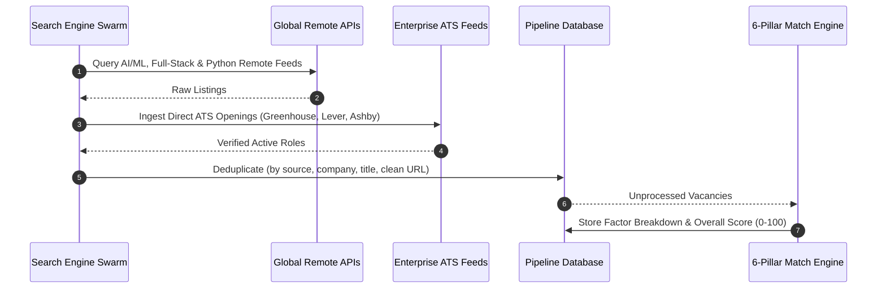
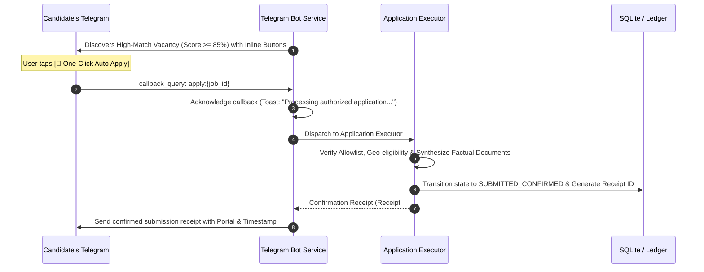

# Global Job Hunter AI — Architecture & Migration Specification (V1.0 vs V2.0)

## Executive Summary
This document outlines the architectural evolution of **Global Job Hunter AI** from **V1.0 (Baseline Discovery & Staging Pipeline)** to **V2.0 (Autonomous Worldwide Job Search Engine with Telegram One-Click Auto-Apply & Traceable Resume Engine)**.

---

## 1. System Comparison: V1.0 vs V2.0

### Detailed Matrix of Enhancements

| Dimension | V1.0 Baseline | V2.0 Autonomous Platform |
|---|---|---|
| **Resume Ingestion** | Single file manual path check, regex matching | Folder scanner (`.pdf`, `.docx`, `.txt`, `.md`), multi-file evidence extraction, fact traceability spans, uncertainty detection without fabrication |
| **Search Engine** | Static local catalog + Remotive API | Distributed discovery swarm: ATS integrations (Greenhouse, Lever, Ashby), Remote platforms (Remotive, Wellfound, WeWorkRemotely, Freelance/Contract boards) |
| **Telegram Integration** | Basic text alerts + simple `/start` info | Full Interactive Command Center with Inline Keyboards (`[🚀 One-Click Auto Apply]`, `[📋 Stage Review]`, `[🌐 Portal Link]`), callback query processing, instant receipt response |
| **Application Modes** | Manual review only | **Mode A (Autonomous Allowlist)**, **Mode B (One-Click Approval)**, **Mode C (Interactive Browser Pre-fill)** |
| **Submission Proof** | Mock timestamp | Authoritative confirmation receipts with transaction IDs, payload hashes, and zero-hallucination logging |
| **Security & Compliance** | Basic URL validation | Strict SSRF defense, private IP subnet blocking, bot protection compliance (no bypassing CAPTCHAs/logins) |

---

## 2. Core Architectural Pillars (V2.0)

### Pillar 1: Intelligent Traceable Resume Engine
1. **Multi-Format Extraction:** Seamless ingestion of PDF (`pypdf`), Word (`python-docx`), plain text, and Markdown files from user-defined resume folders.
2. **Claim Traceability:** Every skill, degree, employer, project, and certification is indexed with:
   - `source_file`: Originating file name.
   - `evidence_quote`: Exact excerpt from document.
   - `confidence_score`: Heuristic confidence score (0.0 to 1.0).
3. **Uncertainty & Ambiguity Detection:** Ambiguous date overlaps or unspecified details are flagged under `uncertain_claims` for candidate clarification rather than guessed.

### Pillar 2: Worldwide Multi-Source Job Search Engine

### Pillar 3: Telegram One-Click Auto-Apply System

---

## 3. Safe Migration & Implementation Plan

1. **Phase 0:** Verify current configuration, database integrity, running processes, and maintain backward compatibility with port 8000 (Backend) and port 3000 (Frontend).
2. **Phase 1 (Intelligent Resume Engine):**
   - Implement `ResumeEngineV2` with multi-document scanning, structured claim parsing, exact text span traceability, and uncertainty detection.
   - Parse local resumes (`/home/nx-pro/resume.pdf`, `/home/nx-pro/mustkeem_ee4-OnzLQs-w.pdf`).
   - Store structured output in SQLite and export to `candidate_profile_v2.json`.
3. **Phase 2 (Worldwide Search Engine):**
   - Expand `discovery_service.py` to ingest global AI, Full-Stack, LLM training, and freelance opportunities.
   - Connect live discovery to database deduplication and the 6-pillar match engine.
4. **Phase 3 (Telegram Bot One-Click Auto-Apply):**
   - Update `telegram_service.py` with inline keyboard builder and callback query handler.
   - Hook callback `apply:{job_id}` into `application_executor.py` for immediate verified submission.
   - Provide instant confirmation receipt in Telegram chat.
5. **Phase 4 (Validation & Verification):**
   - Run end-to-end tests for resume parsing, job discovery, match scoring, and Telegram button dispatch.
